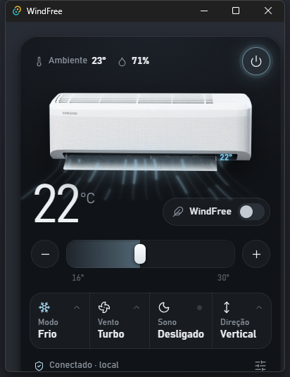

# WindFree — local control for Samsung WindFree air conditioners

A lightweight Windows tray app that controls a **Samsung WindFree** air conditioner
**100% locally** over your Wi‑Fi — no SmartThings cloud, no account, no monthly API
fees. It talks straight to the unit on your LAN using Samsung's OCF local protocol
(DTLS 1.2 + CoAP with CBOR).

Built with **Rust + Tauri**: ~5 MB installer, ~35 MB RAM. Lives in the tray with the
current set temperature drawn on the icon, and starts with Windows.



## Features

- **Local control, no cloud** — power, temperature, mode (Cool / Dry / Fan / Auto),
  fan speed, swing direction, WindFree / Sleep, display, beep, auto‑clean.
- **Live 3D model** — the unit reacts to what you set: airflow by fan speed, the
  WindFree micro‑holes, the display showing the temperature, and the louvers
  animating when swing is on.
- **Favorites** — save a climate you like and re‑apply it in one tap.
- **Energy** — running kWh, a rough monthly cost estimate (set your R$/kWh) and a
  mini chart.
- **Off‑timer** — turn the AC off in 1 / 2 / 4 / 8 h.
- **Alerts** — filter cleaning, unit offline, or "running for too long".

## How it works

Samsung WindFree units expose a local OCF endpoint (UDP, DTLS 1.2 + CoAP). Auth is a
self‑signed EC certificate that carries Samsung's **global cloud UUID** in its
subject — that UUID is provisioned into every unit's ACL during normal SmartThings
onboarding, so a locally‑generated cert is accepted on any AC you have already
paired. The unit does not verify certificate chains, only that UUID. The app
generates and caches the cert on first run; nothing is ever sent to the cloud.

## Setup

1. Install the app (grab the installer from **Releases**, or build from source below).
2. Tell it which unit to control with a `device.json` in the app's data folder
   (`%APPDATA%\com.windfree.tray\device.json`):

   ```json
   { "id": "YOUR-SMARTTHINGS-DEVICE-ID", "nome": "Living room" }
   ```

   Get the device id from the SmartThings API
   (`GET https://api.smartthings.com/v1/devices` with a personal access token) or
   from the device details in the SmartThings app.
3. The app finds that unit on your LAN and controls it locally.

> `device.json` and the generated certificate stay on your machine — they are
> git‑ignored and never leave your network.

## Build from source

Requirements: [Rust](https://rustup.rs), Node.js, and the
[Tauri prerequisites](https://v2.tauri.app/start/prerequisites/). On Windows the
vendored OpenSSL build also needs **Strawberry Perl** and **NASM** on `PATH`.

```bash
npm install
npm run tauri build      # installer lands in src-tauri/target/release/bundle/
# or, for development:
npm run tauri dev
```

## Credits

Local OCF protocol research builds on the excellent
[SmartThings‑Local](https://github.com/QuiteYellow/SmartThings-Local) /
ha‑samsung‑ac‑local work. This app is an independent, native reimplementation.

## Disclaimer

Not affiliated with or endorsed by Samsung. Use at your own risk, on hardware you
own. "SmartThings" and "WindFree" are trademarks of Samsung Electronics.
