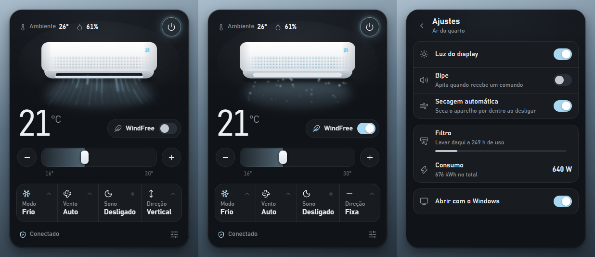

# Samsung WindFree na bandeja do Windows

Um painel no canto do relógio do Windows para controlar o ar-condicionado Samsung WindFree pelo SmartThings. O ícone mostra a temperatura programada e, com um clique, abre o painel.



## O que dá para fazer

- Ligar e desligar, e mudar a temperatura de 16 a 30 °C pela barra ou pelos botões − e +
- Trocar o modo (resfriar, desumidificar, ventilar ou automático), a velocidade do vento e a direção da aleta
- Ligar o WindFree e o modo sono
- Ver a temperatura e a umidade medidas pelo próprio ar
- Nos ajustes: luz do display, bipe, secagem automática, uso do filtro e consumo de energia
- Abrir junto com o Windows (dá para desligar nos ajustes)

O desenho do ar no painel segue o estado real do aparelho. O vento muda de cor com o modo (azul no frio, verde no seco), de ritmo com a velocidade e balança conforme a direção escolhida. No WindFree a aleta fecha e o ar sai pelos microfuros, como no aparelho de verdade.

## Requisitos

- Windows 10 ou 11
- [Node.js](https://nodejs.org) 20 ou mais novo
- O ar já configurado no app SmartThings, numa conta Samsung

Testado num Samsung WindFree de 9.000 BTUs só frio, modelo 2024. Outros WindFree devem funcionar, mas alguns ajustes podem não existir no seu modelo.

## Instalação

```powershell
git clone https://github.com/c0dag/samsung-windfree-tray-app.git
cd samsung-windfree-tray-app
npm install
npm start
```

Sem git, baixe pelo botão **Code > Download ZIP**, extraia e rode `npm install` e `npm start` dentro da pasta.

Na primeira vez:

1. O navegador abre pedindo login na conta Samsung. É o login oficial do SmartThings CLI; entre e autorize.
2. O app procura o primeiro ar-condicionado da sua conta e guarda qual é no arquivo `device.json`.
3. Aparece um ícone com a temperatura no canto do relógio.

Depois disso ele abre sozinho com o Windows. Se mover a pasta de lugar, rode `npm start` de novo para atualizar o início automático.

O Windows 11 esconde ícones novos na setinha ^ da bandeja. Para deixar o ícone sempre à vista, arraste-o para a barra ou ative em **Configurações > Personalização > Barra de tarefas > Outros ícones da bandeja**, onde ele aparece como "Electron".

## Uso

- Clique no ícone para abrir o painel. Clique fora ou aperte Esc para fechar.
- Clique com o botão direito no ícone para ligar ou desligar, atualizar, escolher se abre com o Windows ou sair.
- Com o ar desligado, mudanças de temperatura, modo, vento e direção ficam guardadas e são aplicadas quando você liga. O aparelho ignora esses ajustes enquanto está desligado.
- O rodapé mostra "Sincronizando…" enquanto o comando vai para o ar e avisa quando ele não confirma alguma mudança.

## Mais de um ar na mesma conta

O app usa o primeiro ar que encontrar. Para escolher outro, rode `npx smartthings devices`, copie o ID do aparelho e coloque no `device.json`:

```json
{ "id": "ID-DO-APARELHO", "nome": "Ar da sala" }
```

Apagar o `device.json` faz o app procurar de novo.

## Linha de comando

O script que o app usa também funciona sozinho:

```powershell
node ac.mjs status
node ac.mjs liga temp 22 modo cool
node ac.mjs extra windFree
node ac.mjs desliga
```

| Ação | Valores |
|---|---|
| `liga`, `desliga` | |
| `temp` | 16 a 30 |
| `modo` | `cool`, `dry`, `wind`, `auto` |
| `vento` | `auto`, `low`, `medium`, `high`, `turbo` |
| `extra` | `off`, `windFree`, `windFreeSleep`, `sleep`, `quiet`, `speed` |
| `oscilar` | `fixed`, `vertical`, `horizontal`, `all` |
| `display`, `bipe`, `autoclean` | `on`, `off` |
| `filtroAlerta` | 180, 300, 500 ou 700 horas até avisar para lavar o filtro |
| `zera-filtro` | zera o contador do filtro depois de lavar |

As ações rodam na ordem em que aparecem. A saída é uma linha JSON com o estado do ar, e o campo `pendente` lista o que o aparelho não confirmou. Também existem `tropical`, `limpeza` e `diagnostico`, que ainda foram pouco testados.

## Como funciona

- O app conversa com o ar pela API oficial do SmartThings, usando o login do [SmartThings CLI](https://github.com/SmartThingsCommunity/smartthings-cli). Esse login se renova sozinho e só pede para entrar de novo depois de 30 dias sem uso. Os tokens pessoais do SmartThings expiram em 24 horas, por isso o app não usa esse caminho.
- `ac.mjs` transforma as ações em comandos do SmartThings e confere se o ar aplicou cada um.
- `bridge.js` organiza a fila de comandos. Cliques seguidos viram um comando só.
- `main.js` cuida do ícone, do painel e do início automático, e `panel/` é a interface.

Tudo roda no seu computador. O login fica guardado na pasta de configuração do SmartThings CLI, e o app só fala com a API da Samsung.

## Problemas comuns

- **"Sem resposta do SmartThings"**: confira no app SmartThings se o ar está online e clique em "Tentar de novo" no painel.
- **O navegador abriu sozinho**: o login expirou depois de 30 dias sem uso. Entre de novo na conta Samsung.
- **"Nenhum ar-condicionado encontrado"**: o login precisa ser na mesma conta em que o ar aparece no app SmartThings.
- **"O ar não confirmou…"**: alguns modos não aceitam todos os ajustes. O painel volta para o estado real do aparelho.

## Desinstalar

Desligue "Abrir com o Windows" nos ajustes, clique em **Sair** no menu do ícone e apague a pasta.

## Créditos

Inspirado no app de barra de menus que o [@icanberk](https://x.com/icanberk/status/2109031477484937571) fez para o ar dele no macOS. Ícones do [Lucide](https://lucide.dev).
